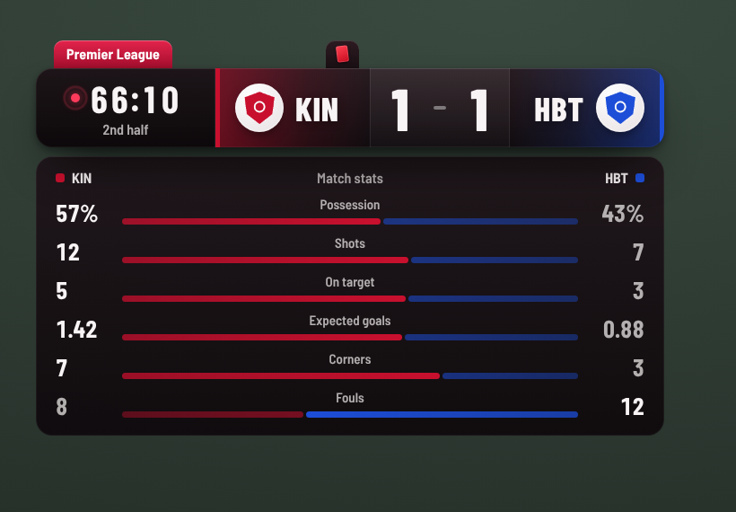
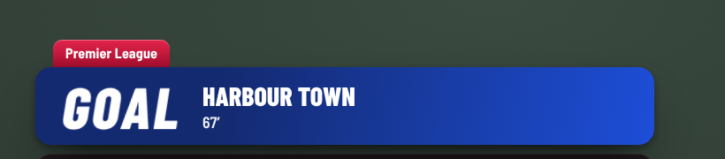
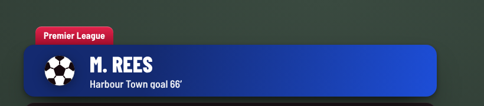
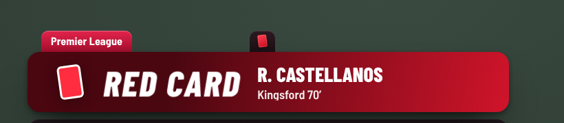
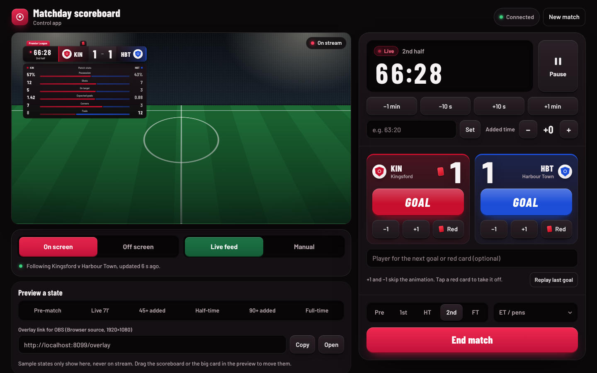

# Matchday scoreboard

A football scoreboard overlay for OBS with a control app for phone or laptop. It can follow a real match by itself from a live data feed, or be run completely by hand.



| Address | What it is |
| --- | --- |
| `/control` | The control app: live feed, clock, score, goals, red cards, stats, what’s on screen, teams |
| `/overlay` | The overlay for OBS: 1920×1080 with a see-through background |

Both pages talk to one small server (`server.js`), so every change shows on every open overlay straight away, from any device. The server needs Node.js 18 or newer and no npm packages.





## What it does

- **Live feed.** Pick the competition (Premier League, Championship, League One, Champions League or Europa League), pick the day, then press **Follow** on a match. Team names, short codes, kit colours, crests and kick-off fill in by themselves. From then on the scoreboard follows the match: score and scorers, red cards, stats, the period and the clock, extra time and penalties.
- **Goal button for speed.** Live feeds run a little behind the TV. Press **Goal** the moment it goes in and the animation plays straight away. When the feed catches up, the overlay shows who scored.
- **Red cards** appear as cards on top of the scoreboard, over the team that got them, with their own animation.
- **Manual.** One switch stops the feed completely, and nothing changes unless you change it. The feed stops using requests too.
- **On screen / Off screen** takes the whole overlay off stream and puts it back.
- **Overall size**, plus separate sizes, positions and dragging for the scoreboard and the big stats card.
- **Stats you choose.** Pick up to 8 of 14 (possession, shots, on target, expected goals, corners, fouls, yellow cards, offsides, saves, off target, blocked shots, shots in the box, passes and pass accuracy). They show under the scoreboard and on the big card, coloured in each team’s kit.
- **Big stats card** comes up at half-time, before extra time and at full-time, with scorers and red cards.

## Live data: API-Football

The live feed uses [API-Football](https://www.api-football.com). Make an account on their dashboard and copy your API key.

- The **free plan** allows 100 requests a day. That’s enough to try it, and with updates every 2 minutes it just about covers one match.
- The **Pro plan** allows 7,500 a day, enough for updates every 15 or 30 seconds all season.

The control app shows roughly how many requests a full match will use at each update speed, and how many you have left today. If the feed sends back an error (a wrong key, a plan limit), the control app shows its message.

If your key comes from RapidAPI instead of the API-Football dashboard, set `RAPIDAPI_KEY` rather than `API_FOOTBALL_KEY`.

### How live and manual work together

- Goals and red cards you press by hand stay on screen for up to 5 minutes while the feed catches up. If the feed never shows them (a goal ruled out by VAR, say), they come off by themselves.
- Taking a goal or card off with **−1** or by tapping it keeps it off, even if the feed still has it.
- If you end a half before the feed does, your choice holds for 3 minutes while the feed catches up.
- The nudge buttons move the live clock so it lines up with the TV picture. The shift stays for the rest of the match.
- Typing a colour or uploading a crest yourself stops the feed replacing it.

## Try it on your computer

```bash
node server.js
```

Open http://localhost:8080/control, and http://localhost:8080/overlay in another window.

With a control key and live data:

```bash
CONTROL_KEY=pick-a-key API_FOOTBALL_KEY=your-api-key node server.js
```

On Windows PowerShell: `$env:CONTROL_KEY="pick-a-key"; $env:API_FOOTBALL_KEY="your-api-key"; node server.js`

## Put it on GitHub

Upload everything in this folder to a new repository and keep the layout: `server.js`, `feed.js`, `package.json` and `Dockerfile` at the top, the pages in `public/`. The `data/` folder is created by the server and is ignored by Git.

## Deploy on Northflank

1. Connect your GitHub account to Northflank.
2. Create a new service and choose **Combined**, so it builds and deploys every time you push.
3. Pick the repository and branch, and choose **Dockerfile** as the build type.
4. Check the port: the Dockerfile exposes **8080**. It should be HTTP and public.
5. Add these runtime variables:
   - `CONTROL_KEY`: a password. Whoever runs the control app types it in once on each device.
   - `API_FOOTBALL_KEY`: your API-Football key, for live data.
6. Optional: add a health check on the path `/healthz`.
7. Optional: attach a volume mounted at `/app/data`, so the match, teams and crests survive restarts and redeploys. Without one, they reset when the service restarts.
8. Deploy. The control app is at `https://<your service address>/control` and the overlay at `https://<your service address>/overlay`.

Run a single instance. The match lives in the server’s memory, so two instances would each keep their own copy.

## Add it to OBS

1. Add a **Browser** source.
2. Set the URL to `https://<your service address>/overlay`.
3. Set the width to `1920` and the height to `1080`.

The overlay page has no buttons, so it can stay on screen all stream. If the connection drops, the clock keeps running and the page reconnects by itself. The control app shows the overlay link with a Copy button.

## The control app



- **Under the preview:** **On screen / Off screen** and **Live feed / Manual**, with a line saying what the feed is doing.
- **Clock:** pause, nudge, or type a time such as `63:20` (or `45+2` in added time). **Added time** shows a `+4 min` tab.
- **Score:** **Goal** plays the animation in that team’s colour. Type a player first to show their name. **+1** and **−1** skip the animation. **Red** gives that team a red card. Tap a red card on a team to take it off. **Replay last goal** plays the last goal again.
- **Periods:** the red button walks through the match (Kick off, End 1st half, Start 2nd half, End match). **ET / pens** covers extra time and penalties.
- **Live match feed:** competition, day, the match list, update speed, kit colours, crests and requests left.
- **Stats:** choose what shows. Stats that come from the live feed update by themselves, so their buttons switch off. In Manual you set them.
- **Preview a state** shows sample numbers in the preview only. The tag on the preview says what viewers see: *On stream*, *Off screen*, *Preview only*, or a connection warning.

## Settings

| Variable | What it does |
| --- | --- |
| `CONTROL_KEY` | Password for making changes. Without it, anyone with the control link can change the scoreboard. |
| `API_FOOTBALL_KEY` | API-Football key for live data. Without it, the app runs in manual only. |
| `RAPIDAPI_KEY` | Use instead of `API_FOOTBALL_KEY` if the key comes from RapidAPI. |
| `MATCH_TIMEZONE` | Time zone for kick-off times. Default `Europe/London`. |
| `PORT` | Port to listen on. Default `8080`. |
| `DATA_DIR` | Where the match is saved. Default `data/` next to `server.js`. |

## Files

```
server.js              the server: pages, saved match, live updates
feed.js                the live feed: match list, following a match, goals, cards, stats, clock
public/match.js        match rules shared by the server and the pages
public/scoreboard.js   draws the overlay (also used for the control app's preview)
public/scoreboard.css  overlay styles
public/overlay.html    the page OBS shows
public/control.html    the control app
public/control.js      control app logic
public/control.css     control app styles
Dockerfile             build for Northflank or any Docker host
```

Fonts come from Google Fonts (Barlow), so the OBS machine needs internet access, which a stream has anyway.
